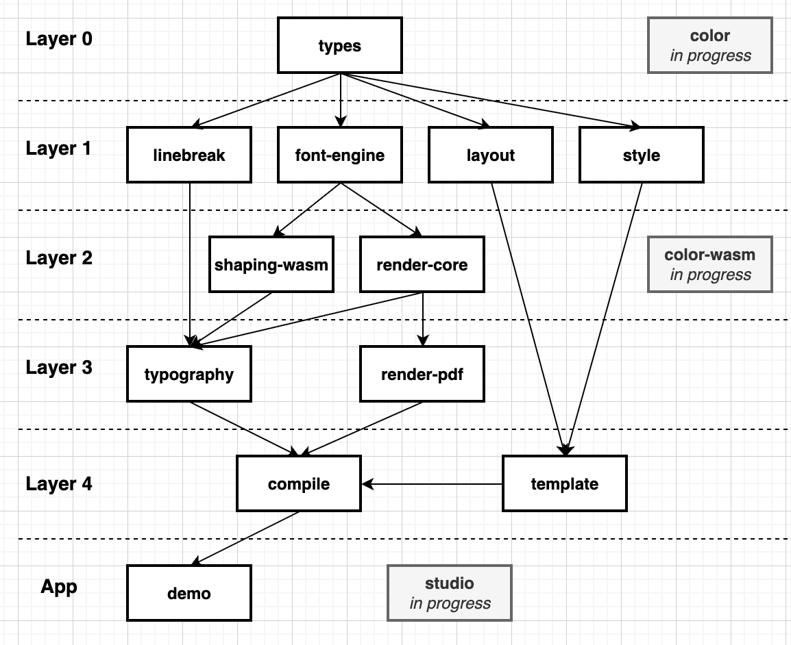

# paragraf

[](https://github.com/kadetr/paragraf/actions/workflows/ci.yml)

**Publication-quality typesetting in JavaScript.** A Node.js library for print-grade output: Knuth-Plass optimal line breaking with real OpenType shaping, 22-language hyphenation, Unicode BiDi, optical margin alignment, and multi-frame document composition — outputting PDF, SVG, or Canvas.

**[→ Live demo](https://kadetr.github.io/paragraf/)**

---

## The problem

Generating documents programmatically in Node.js means choosing between:

- **Headless Chrome / Puppeteer** — renders HTML to PDF. Quality is whatever CSS gives you: greedy line breaking by default, dictionary hyphenation only where the browser ships one, no control over glyph-level metrics. Output looks like a webpage printed to PDF.
- **pdfmake / jsPDF** — programmatic PDF, but greedy line breaking and no OpenType shaping. Adequate for invoices and reports where typography quality doesn't matter.
- **react-pdf** — React components to PDF, with a Knuth-Plass line breaker and fontkit shaping. A good fit for component-style layouts; it does not offer optical margin alignment, ICC colour management, or InDesign-style paragraph styles.
- **LaTeX and Typst pipelines** — publication quality, but they run as a separate process with their own markup language and templating. Not Node libraries.
- **InDesign Server** — the professional standard. Expensive, GUI-dependent, operationally complex, and not scriptable in JavaScript.

**Where paragraf fits:** publication-quality typesetting as a Node.js library, with the print-production parts (optical margins, ICC colour, paragraph styles, multi-frame documents) included. No TeX installation, no browser process, no InDesign licence. The same paragraph-composition techniques InDesign and TeX use, scriptable from TypeScript.

---

## What makes the difference

The core of every professional typesetting engine — InDesign, TeX, QuarkXPress — is the **Knuth-Plass algorithm**: solve the entire paragraph at once, minimising total spacing deviation across all lines simultaneously. The difference is visible:

Most JavaScript PDF libraries use a greedy algorithm — fill each line as full as possible, no lookahead. It's fast and simple, but it produces rivers of white space and inconsistent line density. (react-pdf is an exception: its text layout also runs Knuth-Plass.) But optimal line breaking is only one layer. Five things together are what paragraf is built around:

**Real text shaping.** Most libraries measure text with a canvas element or multiply character count by an average advance width. paragraf runs rustybuzz — a Rust port of HarfBuzz, the same shaping engine used by Firefox, Chrome, and Android — for every text run. GSUB ligature substitution, GPOS kerning, correct Arabic/Hebrew advance widths, per-run OpenType feature flags. The output is metrically identical to what a desktop application produces, not an approximation.

**Optical margin alignment.** A two-pass algorithm that protrudes punctuation and soft-hyphens partially into the page margin, then re-runs Knuth-Plass with the adjusted column widths. The result is a visually flush edge on justified text — the technique InDesign calls "optical margin alignment" and TeX calls `\pdfprotrudechars`. We are not aware of another JavaScript PDF library that implements this.

**ICC colour management.** `@paragraf/color` implements the ICC transform pipeline for the sRGB and CIE Lab colour spaces: profile parsing, sRGB → Lab conversion, and tetrahedral LUT interpolation. CMYK output uses device-profile LUT lookups (B2A tables); full gamut-mapping and chromatic adaptation are partial. For commercial printing that mandates a specific output-device profile (Fogra39, SWOP), the transform produces correct colour for profiles with 8-bit B2A LUTs. We are not aware of another Node.js PDF library that provides ICC-based colour transforms.

**Style inheritance.** `@paragraf/style` provides InDesign-equivalent paragraph styles and character styles with cascading inheritance — derived styles override only what they change, in a named style registry. This is what makes template-driven documents maintainable at scale.

**A single entry point for the full pipeline.** `@paragraf/compile` orchestrates all layers — font discovery, style registry, page geometry, paragraph composition, glyph layout, PDF/SVG output — behind one `compile()` call. You can drive the entire pipeline from a template definition and a data object, or drop in at any layer for custom workflows.

---

## How it compares

| Capability | paragraf | Puppeteer | pdfmake | react-pdf | LaTeX | Typst |
|---|:---:|:---:|:---:|:---:|:---:|:---:|
| Knuth-Plass (whole-paragraph) line breaking | ✅ | — | — | ✅ | ✅ | ✅ |
| Real OpenType shaping (GSUB/GPOS) | ✅ | ✅¹ | — | ✅² | ✅ | ✅ |
| Multi-language hyphenation | ✅ (22) | via CSS | — | ✅ | ✅ | ✅ |
| Unicode BiDi (Arabic, Hebrew) | partial³ | ✅ | — | ✅ | partial | ✅ |
| Optical margin alignment | ✅ | — | — | — | ✅ | ✅ |
| Multi-frame / multi-column layout | ✅ | via CSS | ✅ | via flexbox | ✅ | ✅ |
| Selectable text in PDF output | ✅ | ✅ | ✅ | ✅ | ✅ | ✅ |
| Node-native (no subprocess, no separate toolchain) | ✅ | — | ✅ | ✅ | — | —⁴ |
| Open source | ✅ | ✅ | ✅ | ✅ | ✅ | ✅ |

This table reflects our reading of each project's documentation in November 2026. If an entry is out of date, please open an issue.

¹ Chromium shapes text with HarfBuzz. Shaping can only be influenced through CSS (`font-feature-settings` and related properties), not addressed per glyph.  
² react-pdf shapes text with fontkit, the same library paragraf uses as its fallback when the WASM shaper is absent.  
³ Paragraph-level direction detection and visual reordering via the first-strong character heuristic. Full Unicode Bidirectional Algorithm (UBA) line-level reordering is not yet implemented.  
⁴ Typst is a Rust compiler with its own markup language. It can be called from Node as a command-line tool or through community WebAssembly bindings.

**Browser path.** The packages that run in a browser without modification are: `@paragraf/types`, `@paragraf/linebreak`, `@paragraf/layout`, `@paragraf/style`, and `@paragraf/render-core`. Pair them with a custom `FontEngine` that loads fonts via `fetch`. `@paragraf/color` (it reads profiles from disk), `@paragraf/typography`, `@paragraf/render-pdf`, `@paragraf/shaping-wasm`, `@paragraf/compile`, and `@paragraf/font-engine` (with the built-in adapters) are Node-only.

**For browser-side KP line breaking** (injecting optimal word spacing back into DOM text), see [tex-linebreak](https://github.com/robertknight/tex-linebreak) by robertknight. That is a different problem — paragraf is a print and PDF pipeline, not a browser text renderer.

---

## Packages

Twelve packages in strict layers. Each package only imports from layers below it.

| Folder | Package | What it does | Env |
|---|---|---|:---:|
| `0-types/` | `@paragraf/types` | Zero-dep shared interfaces: `Font`, `ComposedLine`, `FontRegistry`, `TextSpan` | both |
| `0-color/` | `@paragraf/color` | ICC colour profiles, sRGB/Lab/CMYK spaces, LUT interpolation | both |
| `1a-linebreak/` | `@paragraf/linebreak` | Knuth-Plass algorithm, 22-language hyphenation, traceback, node builder | both |
| `1b-font-engine/` | `@paragraf/font-engine` | FontEngine interface, fontkit adapter, measurer factory | Node⁵ |
| `1c-layout/` | `@paragraf/layout` | Page geometry, unit converters (mm/in/cm), named page sizes (A4, Letter…) | both |
| `1d-style/` | `@paragraf/style` | Paragraph and character style definitions with cascading inheritance | both |
| `2a-shaping-wasm/` | `@paragraf/shaping-wasm` | Rust/WASM OpenType shaper (rustybuzz): GSUB ligatures, GPOS kerning, sups/subs | Node |
| `2b-render-core/` | `@paragraf/render-core` | Glyph layout → SVG / Canvas, document types | both |
| `3a-typography/` | `@paragraf/typography` | Paragraph compositor, OMA, BiDi, document model | Node |
| `3b-render-pdf/` | `@paragraf/render-pdf` | PDF output via pdfkit, selectable text overlay | Node |
| `4a-template/` | `@paragraf/template` | Document schema: named content slots, style bindings, page size declarations | Node |
| `4b-compile/` | `@paragraf/compile` | Full pipeline: template + data + fonts → PDF / SVG / RenderedDocument | Node |

⁵ The `FontEngine` interface is environment-agnostic, but the bundled fontkit adapter (`createMeasurer`, `FontkitEngine`) reads font files from disk via Node's `fs.openSync` and is Node-only. In a browser you must supply your own `FontEngine` implementation backed by `fetch`/`ArrayBuffer`.

---

## Architecture



`3a-typography` and `3b-render-pdf` are true layer-3 siblings — neither depends on the other. `RenderedDocument` / `RenderedPage` live in `2b-render-core` so `render-pdf` works without `typography` for simpler pipelines.

Layer 4 (`4a-template`, `4b-compile`) sits above both. `@paragraf/compile` is the highest-level entry point — it drives the full pipeline from a template definition and a data object to PDF, SVG, or a `RenderedDocument`, with no boilerplate.

---

## Quick start

### High-level API (`@paragraf/compile`)

The fastest path from data to PDF. One call drives the entire pipeline — font loading, style resolution, page geometry, Knuth-Plass composition, glyph layout, and rendering.

```bash
npm install @paragraf/compile
```

```ts
import { defineTemplate, compile } from '@paragraf/compile';
import { writeFileSync } from 'fs';

const template = defineTemplate({
  layout: { size: 'A4', margins: 72 },
  fonts: {
    'LiberationSerif': {
      regular: './fonts/LiberationSerif-Regular.ttf',
      bold:    './fonts/LiberationSerif-Bold.ttf',
    },
  },
  styles: {
    body: {
      font:       { family: 'LiberationSerif', size: 11 },
      alignment:  'justified',
      lineHeight: 16,
    },
    heading: {
      font:       { family: 'LiberationSerif', size: 18, weight: 700 },
      alignment:  'left',
      lineHeight: 24,
    },
  },
  content: [
    { style: 'heading', text: '{{title}}' },
    { style: 'body',    text: '{{body}}' },
  ],
});

const result = await compile({
  template,
  data: {
    title: 'Of Wishing',
    body:  'In olden times when wishing still helped one, there lived a king '
         + 'whose daughters were all beautiful.',
  },
  output: 'pdf',
});

writeFileSync('output.pdf', result.data as Buffer);
```

`defineTemplate()` validates the template at definition time (style references, binding syntax, inheritance cycles). `compile()` auto-detects the WASM shaper and falls back to fontkit with one warning. Pass `shaping: 'wasm'` to fail instead, or `shaping: 'fontkit'` to choose the fallback on purpose.

### Low-level API (`@paragraf/typography`)

For custom rendering pipelines or when you need direct access to composed lines and glyph positions.

```bash
npm install @paragraf/typography @paragraf/render-pdf
```

`@paragraf/types`, `@paragraf/linebreak`, `@paragraf/font-engine`, `@paragraf/render-core`, and `@paragraf/shaping-wasm` (whose npm package is set up to carry the compiled WASM shaper) are all declared as direct dependencies of `@paragraf/typography` and install automatically.

```ts
import { createParagraphComposer, createDefaultFontEngine } from '@paragraf/typography';
import { createMeasurer }  from '@paragraf/font-engine';
import { layoutParagraph } from '@paragraf/render-core';
import { renderToPdf }     from '@paragraf/render-pdf';
import { writeFileSync }   from 'fs';

// 1. Register fonts — LiberationSerif ships with the repository
const registry = new Map([
  ['body', {
    id: 'body',
    family: 'LiberationSerif',
    filePath: './fonts/LiberationSerif-Regular.ttf',
  }],
]);

// 2. Compose — Knuth-Plass finds optimal line breaks for the whole paragraph
const composer = await createParagraphComposer(registry);
const { lines } = composer.compose({
  text:      'In olden times when wishing still helped one, there lived a king '
           + 'whose daughters were all beautiful.',
  font:      { id: 'body', size: 11, weight: 400, style: 'normal', stretch: 'normal' },
  lineWidth:  396,   // points — 5.5 inches at 72pt/inch
  tolerance:  2,
  alignment: 'justified',
  language:  'en-us',
});

// 3. Layout — positions every glyph on the page
const measurer = createMeasurer(registry);
const rendered = layoutParagraph(lines, measurer, { x: 72, y: 72 });

// 4. Render to PDF — returns a Buffer
const engine    = await createDefaultFontEngine(registry);
const pdfBuffer = await renderToPdf(rendered, engine, {
  width:  595.28,   // A4
  height: 841.89,
});
writeFileSync('output.pdf', pdfBuffer);
```

### Selectable text (search and copy-paste in PDF viewers)

```ts
const pdfBuffer = await renderToPdf(rendered, engine, {
  width:        595.28,
  height:       841.89,
  selectable:   true,      // adds invisible text overlay at exact glyph positions
  fontRegistry: registry,  // required for font embedding
  title:        'My Document',
  lang:         'en',
});
```

### Multi-page documents

```ts
import { composeDocument, layoutDocument } from '@paragraf/typography';
import { renderDocumentToPdf }             from '@paragraf/render-pdf';

const doc = {
  paragraphs: [
    {
      text:      'First paragraph.',
      font:      { id: 'body', size: 11, weight: 400, style: 'normal', stretch: 'normal' },
      lineWidth:  396,
      alignment: 'justified' as const,
    },
    {
      text:           'Second paragraph, indented.',
      font:           { id: 'body', size: 11, weight: 400, style: 'normal', stretch: 'normal' },
      lineWidth:       396,
      alignment:      'justified' as const,
      firstLineIndent: 11,
    },
  ],
  frames: [{
    page: 0, x: 72, y: 72, width: 396, height: 648,
  }],
};

const composed    = composeDocument(doc, composer);
const measurer    = createMeasurer(registry);
const renderedDoc = layoutDocument(composed, doc.frames, measurer);

const pdfBuffer = await renderDocumentToPdf(renderedDoc, engine, {
  pageWidth:  595.28,
  pageHeight: 841.89,
});
writeFileSync('document.pdf', pdfBuffer);
```

---

## Typography features

**Knuth-Plass parameters** — all TeX-equivalent controls exposed:

| Parameter | Default | Description |
|---|---|---|
| `tolerance` | `2` | How aggressively to fit lines; higher = more flexibility |
| `looseness` | `0` | `+1` prefer looser (more lines), `-1` prefer tighter |
| `emergencyStretch` | `0` | Extra stretch budget when no solution found at tolerance |
| `onInfeasible` | `'overfull'` | What happens when the paragraph still cannot be set: `'overfull'` returns lines anyway (lines that fit are set however loose; a piece wider than the measure sticks out and is marked `overfull`), `'throw'` throws an error |
| `firstLineIndent` | `0` | First-line indent in points |
| `consecutiveHyphenLimit` | `∞` | Maximum consecutive hyphenated lines |
| `runtPenalty` | `0` | Demerit added when the final line of a paragraph is a single word (runt line). Best-effort — does not guarantee elimination when no feasible alternative layout exists. |
| `singleLinePenalty` | `0` | Demerit added when the entire paragraph fits on a single line (no intermediate breaks), regardless of word count. Same caveat as `runtPenalty`. |

**Language hyphenation** — 22 languages built in via Knuth–Liang pattern tables:
`en-us` `en-gb` `de` `fr` `tr` `nl` `pl` `it` `es` `sv` `no` `da` `fi`
`hu` `cs` `sk` `ro` `hr` `sl` `lt` `lv` `et`

Note: per-document exception dictionaries are supported via `hyphenation.exceptions`. Sentence-initial capitalised words are not suppressed by the hyphenation engine. Other capitalised words are treated as proper nouns and left whole, except in German (`de`), where every noun is capitalised and capitalised words are hyphenated by default (since v0.7.1). Words in capitals, words that contain a digit and e-mail addresses are never hyphenated.

**URL break points** (since v0.7.1) — a URL (`http://`, `https://`, `ftp://`, `www.…`, or a bare lower-case `host.tld/…` under one of `com org net edu gov info io dev app eu de uk fr es nl ch ca au jp se dk fi cz br cn`) can break after `/ ? & = # _ -` and before `.`, without a hyphen and never inside `://`. Each break carries a penalty, so a URL is only broken where the line would otherwise be clearly loose or overfull. `hyphenation: false` keeps URLs in one piece. `compose()` and `compile()` have no separate switch for URL breaking or for German capitalised words: `hyphenation: false` is the only way back to the 0.7.0 behaviour there (`processCapitalized` and `breakUrls` exist only in `@paragraf/linebreak`).

**OpenType shaping** — via rustybuzz (Rust port of HarfBuzz):
GSUB ligatures, GPOS kerning, superscript (`sups`), subscript (`subs`),
per-run letter-spacing, correct advance widths for all scripts

**Unicode BiDi** — paragraph-level direction detection and visual reordering for Arabic and Hebrew mixed with LTR text. Paragraph direction follows the first-strong character heuristic; full Unicode Bidirectional Algorithm (UBA) line-level reordering is not yet implemented.

**Optical margin alignment** — two-pass recomposition, punctuation hangs into margins,
per-character protrusion table

**Multi-frame document model** — multi-column, multi-frame, multi-page with baseline grid snapping

---

## Known limitations

These are intentional gaps for the current release, not bugs:

- **PDF output is vector-path, not PDF/X-conformant.** Text is rendered as filled glyph outlines. PDF/X and PDF/A require embedded fonts with `TJ` operators and ToUnicode CMaps. This is planned but not yet implemented.
- **`runtPenalty` / `singleLinePenalty` are single-line runt penalties**, not frame-level widow/orphan control. True widow/orphan handling (preventing the first or last line of a paragraph from being isolated on a different page) requires frame-level composition, which is not yet implemented. The penalty is best-effort and may not change the layout when no feasible alternative exists.
- **`adjDemerits`** is available on the paragraph input (`ParagraphInput.adjDemerits`) in both engines. The default is `0`, which preserves backwards-compatible Knuth-Plass behaviour. Set to `10000` for TeX-equivalent quality (penalises jarring transitions between very tight and very loose consecutive lines).
- **Overfull lines are reported, not repaired.** When a single unbreakable piece is wider than the column, the line is wider than the column and sticks out. `compose()` marks it (`line.overfull`, `line.overflow` in points, `usedFallback` on the result) and `compile()` lists it in `metadata.overfullLines`. Since v0.7.1 URLs and German nouns are no longer such pieces: URLs have break points and German capitalised words are hyphenated. Still unbreakable: long numbers, words that contain a digit, words in capitals, e-mail addresses, a bare host name without a path (`example.com`), capitalised words in mid-sentence in languages other than German, and any word or URL in a paragraph with `hyphenation: false`.
- **A line with no space in it cannot be justified.** A line that holds only pieces of one URL, or one fragment of a long hyphenated word, is set at its natural width and can end short of the right edge. Such a paragraph is also still reported in `metadata.fallbackParagraphs`, and throws under `onInfeasible: 'throw'`.
- **URLs in right-to-left paragraphs are unbreakable.** The right-to-left path does no hyphenation and puts no break points into a URL.
- **Proper names in German text are hyphenated with German patterns**, which can be wrong for a foreign name (`Wa-shing-ton`). With `@paragraf/linebreak` directly, `exceptions: { washington: false }` keeps the name whole and `exceptions: { washington: ['Wash', 'ing', 'ton'] }` sets its breaks (the key is the lower-cased token including attached punctuation). `compose()` and `compile()` do not take `exceptions`; a soft hyphen (U+00AD) in the name limits its breaks to that place.
- **The German pattern set makes some poor breaks in long compounds**, for example `Rindflei-` / `schetikettierungs…` (from the shipped `de-1996` patterns).
- **A bare host is only recognised as a URL under a short list of top-level domains** (see "URL break points"). Write the scheme or `www.` for any other domain; without it the token is treated as a word.
- **Letter-spacing and kerning stop at fragment boundaries.** A word with hyphenation points and a URL are measured and drawn in pieces. Letter-spacing is not added between two pieces and kerning is not applied across them, so with tracking such a word is narrower, by the letter-spacing value per boundary, than the same word set with `hyphenation: false`.
- **`nestedStyles` / `grepStyles`** are accepted by the style registry but not yet applied. Character-style rules based on regex or run-length patterns require the inline-markup pipeline (F027) to be wired end-to-end.

---

## Development

```bash
npm install   # install all workspace dependencies
npm test      # unit tests across all packages
npm run build # build all packages to dist/
```

The compiled WASM shaper is **not committed to this repository**. CI builds it for every test run, and the `@paragraf/shaping-wasm` package lists `wasm/pkg/` in its `files`, so a release built with the shaper present will include it. In a fresh clone the shaper is absent, so composition runs on the TypeScript fontkit path until you build it. The Rust source is at `2a-shaping-wasm/wasm/src/lib.rs`. To build it (requires Rust and `wasm-pack`), or to rebuild after modifying the Rust layer:

```bash
cd 2a-shaping-wasm/wasm
wasm-pack build --target nodejs                                   # Node
wasm-pack build --target bundler --out-dir pkg-bundler --release  # Browser (Vite)
```

`@paragraf/typography` auto-detects the WASM shaper at module init. What happens when it is absent depends on the `shaping` option of `createParagraphComposer`, `createDefaultFontEngine`, `compile()` and `createCompilerSession`:

| `shaping` | WASM built | WASM absent or broken |
|---|---|---|
| `'auto'` (default) | WASM | fontkit, with one warning per process or worker thread |
| `'wasm'` | WASM | throws, with the build command in the message |
| `'fontkit'` | fontkit | fontkit, no fallback warning |

Use `'wasm'` in production builds where a silent change of shaping engine would be a defect. Check which path is active:

```ts
import { wasmStatus } from '@paragraf/typography';
console.log(wasmStatus()); // { status: 'loaded' | 'absent' | 'error' }
```

---

## Status

**Pre-release.** The core algorithm and rendering pipeline are stable and well-tested. APIs may change before v1.0. Published to npm under the `@paragraf` scope since v0.7.0; Node 22 or later.

All packages are at **v0.7.0**.
